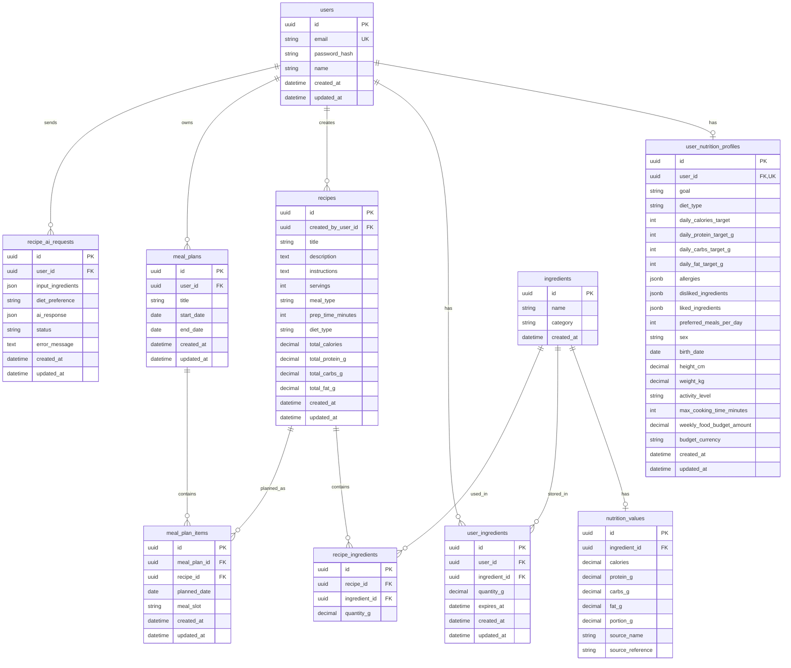

# Mealio Database Schema

This document describes Mealio tables; the ingredient/reference sections below reflect W8 core.

Mealio is a mobile application that allows users to manage available ingredients, generate recipes using AI, calculate nutritional values, and create meal plans.

---

## Main Tables

The first version of the database contains the following tables:

```txt
users
user_nutrition_profiles
ingredients
nutrition_values
user_ingredients
recipes
recipe_ingredients
meal_plans
meal_plan_items
recipe_ai_requests
```

---

## Entity Relationship Diagram



---

## Table Descriptions

---

## 1. users

The `users` table stores registered application users.

Each user can have their own pantry, generated recipes, meal plans, and AI generation history.

### Fields

| Field | Type | Description |
|---|---|---|
| id | UUID | Primary key |
| email | String | Unique user email |
| password_hash | String | Hashed password |
| name | String | User display name |
| created_at | DateTime | Record creation date |
| updated_at | DateTime | Last update date |

### Constraints

| Constraint | Description |
|---|---|
| Primary Key | `id` |
| Unique | `email` |

### Relationships

- One user can have many pantry ingredients.
- One user can create many recipes.
- One user can have many meal plans.
- One user can send many AI recipe generation requests.

---

## 2. ingredients

The `ingredients` table stores base ingredients available in the system.

Examples:

```txt
chicken breast
rice
eggs
milk
oats
banana
tomato
potato
cheese
olive oil
```

### Fields

| Field | Type | Description |
|---|---|---|
| id | UUID | Primary key |
| name | VARCHAR(255), NOT NULL | Human-readable base label, independent of locale |
| category | VARCHAR(100), nullable | Optional free text, no taxonomy |
| created_at | DateTime | Record creation date |

### Constraints

| Constraint | Description |
|---|---|
| Primary Key | `id` |
| Unique | Raw `ix_ingredients_name` and full Unicode15 expression `ux_ingredients_identity_v1` |
| CHECK | `ck_ingredients_identity_v1_valid`: normalized key length 1..1020 |

### Example Categories

```txt
meat
vegetables
fruits
dairy
grains
spices
oils
drinks
other
```

---

UUID remains the sole reference identity; labels are not IDs. Future translated
display labels need separate storage/API. Existing labels are not rewritten.
See [identity policy, migration and recovery](../ingredient-identity.md).

## 3. nutrition_values

The `nutrition_values` table stores nutritional values for each ingredient
for its stored `portion_g`, which defaults to 100 grams.

This separation keeps ingredient information clean and allows nutrition data to be updated independently.

### Fields

| Field | Type | Description |
|---|---|---|
| id | UUID | Primary key |
| ingredient_id | UUID | Foreign key to `ingredients.id` |
| calories | Numeric(8,2) | Calories for `portion_g` |
| protein_g | Numeric(8,2) | Protein grams for `portion_g` |
| carbs_g | Numeric(8,2) | Carbohydrate grams for `portion_g` |
| fat_g | Numeric(8,2) | Fat grams for `portion_g` |
| portion_g | Numeric(8,2) | Finite portion in grams, 0.01..999999.99 inclusive; default 100 |
| source_name | VARCHAR(255), nullable | Public user-declared, unverified source for the current nutrition record |
| source_reference | VARCHAR(1000), nullable | Opaque public reference; requires source_name; never fetched |

### Constraints

| Constraint | Description |
|---|---|
| Primary Key | `id` |
| Foreign Key | `ingredient_id` references `ingredients.id` |
| Unique | `ingredient_id` |
| CHECK | `ck_nutrition_values_portion_g_bounds`: `portion_g BETWEEN 0.01 AND 999999.99` |
| CHECK | `ck_nutrition_values_source_pair`: `source_reference IS NULL OR source_name IS NOT NULL` |

### Relationship

- One ingredient has at most one nutrition value record.

See the [portion contract and damaged-data rollout runbook](../ingredient-portion-storage.md).
See [declared provenance and writer-version delivery policy](../nutrition-provenance.md).
Migration `c213a7e94b02` follows `b205c8d15a01`; existing rows gain NULL metadata
without source inference or numeric changes. Downgrade loses only this metadata.

---

## 4. user_ingredients

The `user_ingredients` table stores ingredients that a specific user currently has at home.

This table represents the user's pantry.

### Fields

| Field | Type | Description |
|---|---|---|
| id | UUID | Primary key |
| user_id | UUID | Foreign key to `users.id` |
| ingredient_id | UUID | Foreign key to `ingredients.id` |
| quantity_g | Numeric(10,2) | Quantity in grams |
| expires_at | DateTime, nullable | Expiration date/time |
| created_at | DateTime | Record creation date |
| updated_at | DateTime | Last update date |

### Constraints

| Constraint | Description |
|---|---|
| Primary Key | `id` |
| Unique | `(user_id, ingredient_id)` |
| Foreign Key | `user_id` references `users.id` |
| Foreign Key | `ingredient_id` references `ingredients.id` |

### Relationships

- One user can have many pantry items.
- One ingredient can appear in many user pantries.

---

## 5. recipes

The `recipes` table stores recipes created manually or generated by AI.

A recipe belongs to a user and contains title, description, instructions, servings,
optional meal type and preparation time, diet type, and calculated nutrition summary.

### Fields

| Field | Type | Description |
|---|---|---|
| id | UUID | Primary key |
| created_by_user_id | UUID, nullable | Foreign key to `users.id` |
| title | String | Recipe title |
| description | Text | Short recipe description |
| instructions | Text | Step-by-step cooking instructions |
| servings | Integer | Whole-recipe serving count, 1–12; default 1 |
| meal_type | String(100), nullable | Optional recipe classification, independent of a planner slot |
| prep_time_minutes | Integer, nullable | Declared preparation duration in minutes, 1–480; null means unknown |
| diet_type | String | Diet classification |
| total_calories | Decimal | Total calories for the recipe |
| total_protein_g | Decimal | Total protein for the recipe |
| total_carbs_g | Decimal | Total carbohydrates for the recipe |
| total_fat_g | Decimal | Total fat for the recipe |
| created_at | DateTime | Record creation date |
| updated_at | DateTime | Last update date |

### Servings contract (W10)

Recipe POST, PATCH and AI preview save accept `servings` as a JSON integer in
`1..12`; null, booleans, strings and floats return 422. POST/save omission uses 1;
PATCH omission preserves the saved value. Recipe detail/list and save responses
include the count. AI preview save forwards it to the same recipe creation flow.
Existing clients can keep omitting it; to retain a generated count they must send
the preview's `servings` when saving. Preview-generation validation is unchanged.

Migration `d124b6e83a01` follows `c213a7e94b02` and adds a NOT NULL integer with
server default 1 and CHECK `ck_recipes_servings_range`. Existing rows receive 1
as a compatibility convention; their historical serving counts are unknown.
No historical nutrient totals, gram quantities or timestamps are recalculated.
Downgrade removes only the count and its constraint; re-upgrade assigns 1 again.
Deploy the migration before the backend that reads this field. Older writers
omitting the field receive the database default and preserve it on updates.

Quantities and `total_*` remain totals for the whole recipe. Changing only the
count leaves them intact. Each planner slot still accounts for one whole recipe,
and shopping lists still use its full gram quantities. Per-serving projections,
planned serving counts and scaling require a separate contract. Preparation time
is optional recipe metadata under the contract below; it is not scaled by servings.

### Recipe meal type contract (W10)

Recipe POST, PATCH and AI preview save accept an optional `meal_type` label.
The API strips surrounding whitespace and lowercases text, then validates a
maximum of 100 characters. Empty/whitespace-only text becomes null; non-text,
overlength text and characters unsupported by PostgreSQL UTF8 return 422 before
any writes. Labels are open text (including `brunch`), not a fixed enum.
POST/save omission uses null; PATCH omission preserves the saved label, while
explicit null or blank clears it. Detail/list/save responses include the label.

Examples: POST with `"  DiNnEr  "` returns `"dinner"`; an old client omitting
the field receives null; a title-only PATCH retains `"dinner"`; PATCH with null
clears it. An invalid label alongside a new title returns 422 and changes neither.
AI-save callers must send their chosen label explicitly. AI generation request,
provider schema and generated preview response are unchanged by this slice;
the backend does not infer a classification from ingredients or planner usage.

Migration `e235c7f94b02` follows `d124b6e83a01`, adding a nullable VARCHAR(100)
without a default. Historical classifications remain unknown (null); other
fields, serving counts, totals, grams and timestamps are preserved. Install the
migration before the application that reads the column. Legacy writers omitting
it continue to work. Application rollback can retain the column; downgrade
removes only the recipe label and loses its values. Re-upgrade restores null.

Recipe classification is independent of `meal_plan_items.meal_type`: a recipe
labelled dinner can be scheduled in a breakfast slot. Changing/clearing the
recipe label does not reclassify existing slots, change planner/shopping filters,
rescale nutrition or grams, or change recipe ownership. This slice adds no list
filter, planner automation or Flutter UI. Preparation-time persistence has its
own contract below.

### Recipe preparation time contract (W10)

Recipe POST, PATCH and AI preview save accept optional `prep_time_minutes` as a
strict JSON integer in `1..480`, or null for an unknown duration. Create/save
omission uses null. PATCH omission preserves the saved value; explicit null
clears it. Booleans, strings (including blank), floats and out-of-range values
return 422 without writes. Detail/list/save responses include the duration.

Examples: saving an AI preview with `prep_time_minutes=30` retains 30 on GET;
an old create/save request receives null; a title-only PATCH preserves 30;
PATCH with null clears it. PATCH with a new title and `prep_time_minutes=0`
returns 422 and leaves both fields unchanged. AI-save callers must forward the
preview's duration explicitly. AI generation/provider validation is unchanged.

Migration `f346d8a05c03` follows `e235c7f94b02`, adding a nullable INTEGER with
CHECK `ck_recipes_prep_time_minutes_range` (`BETWEEN 1 AND 480`, null allowed).
No default or historical duration is inferred. All existing rows, metadata,
servings, nutrient totals, quantities and timestamps are preserved. Apply the
migration before the reading backend starts. Old writers can omit the column;
application rollback can retain it. Downgrade loses only the duration and its
constraint; re-upgrade restores null, not the previous duration.

The duration is declared metadata, not a measured or independently verified
estimate. Changing/clearing it does not rescale totals or grams, alter planner
slots/shopping lists, enforce cooking-time preferences, or change ownership.
Search/filtering, recommendations, planner scheduling, Flutter UI and additional
recipe metadata are separate work; this slice only preserves the chosen value.

### Example Diet Types

```txt
normal
diet
vegan
vegetarian
high_protein
low_carb
weight_loss
mass_gain
gluten_free
```

### Constraints

| Constraint | Description |
|---|---|
| Primary Key | `id` |
| Foreign Key | `created_by_user_id` references `users.id` (`ON DELETE SET NULL`) |
| Check | `servings BETWEEN 1 AND 12` |

### Relationships

- One user can create many recipes.
- One recipe can contain many ingredients.
- One recipe can be used in many meal plan items.

---

## 6. recipe_ingredients

The `recipe_ingredients` table stores the ingredients used in a recipe.

This table creates a many-to-many relationship between `recipes` and `ingredients`.

### Fields

| Field | Type | Description |
|---|---|---|
| id | UUID | Primary key |
| recipe_id | UUID | Foreign key to `recipes.id` |
| ingredient_id | UUID | Foreign key to `ingredients.id` |
| quantity_g | Numeric(10,2) | Ingredient grams used in the recipe |

### Constraints

| Constraint | Description |
|---|---|
| Primary Key | `id` |
| Foreign Key | `recipe_id` references `recipes.id` |
| Foreign Key | `ingredient_id` references `ingredients.id` |

### Relationships

- One recipe can contain many recipe ingredient records.
- One ingredient can be used in many recipe ingredient records.

---

## 7. meal_plans

The `meal_plans` table stores user meal plans.

A meal plan belongs to one user and can contain multiple planned recipes.

### Fields

| Field | Type | Description |
|---|---|---|
| id | UUID | Primary key |
| user_id | UUID | Foreign key to `users.id` |
| title | String | Meal plan title |
| start_date | Date | Meal plan start date |
| end_date | Date | Meal plan end date |
| created_at | DateTime | Record creation date |
| updated_at | DateTime | Last update date |

### Constraints

| Constraint | Description |
|---|---|
| Primary Key | `id` |
| Foreign Key | `user_id` references `users.id` |

### Relationships

- One user can have many meal plans.
- One meal plan can contain many meal plan items.

---

## 8. meal_plan_items

The `meal_plan_items` table stores recipes assigned to specific days and meal slots inside a meal plan.

### Fields

| Field | Type | Description |
|---|---|---|
| id | UUID | Primary key |
| meal_plan_id | UUID | Foreign key to `meal_plans.id` |
| recipe_id | UUID | Foreign key to `recipes.id` |
| planned_date | Date | Planned meal date |
| meal_slot | String | Meal slot |
| created_at | DateTime | Record creation date |
| updated_at | DateTime | Last update date |

### Example Meal Slots

```txt
breakfast
lunch
dinner
snack
```

### Constraints

| Constraint | Description |
|---|---|
| Primary Key | `id` |
| Foreign Key | `meal_plan_id` references `meal_plans.id` |
| Foreign Key | `recipe_id` references `recipes.id` |

### Relationships

- One meal plan can contain many meal plan items.
- One recipe can appear in many meal plan items.

---

## 9. recipe_ai_requests

The `recipe_ai_requests` table stores AI recipe generation requests and responses.

This table is useful for debugging, analytics, product evaluation, and tracking AI output quality.

### Fields

| Field | Type | Description |
|---|---|---|
| id | UUID | Primary key |
| user_id | UUID | Foreign key to `users.id` |
| input_ingredients | JSON | Ingredients sent to AI |
| diet_preference | String | User diet preference |
| ai_response | JSON | Raw or structured AI response |
| status | String | Request status |
| error_message | Text | Error message if generation failed |
| created_at | DateTime | Record creation date |
| updated_at | DateTime | Last update date |

### Example Statuses

```txt
pending
completed
failed
```

### Constraints

| Constraint | Description |
|---|---|
| Primary Key | `id` |
| Foreign Key | `user_id` references `users.id` |

### Relationships

- One user can send many AI recipe generation requests.

---

## Relationship Summary

| Relationship | Type | Description |
|---|---|---|
| users → user_ingredients | One-to-many | One user can have many pantry items |
| users → recipes | One-to-many | One user can create many recipes |
| users → meal_plans | One-to-many | One user can have many meal plans |
| users → recipe_ai_requests | One-to-many | One user can send many AI requests |
| ingredients → nutrition_values | One-to-zero-or-one | One ingredient may have a nutrition record |
| ingredients → user_ingredients | One-to-many | One ingredient can appear in many user pantries |
| ingredients → recipe_ingredients | One-to-many | One ingredient can be used in many recipes |
| recipes → recipe_ingredients | One-to-many | One recipe contains many ingredients |
| recipes → meal_plan_items | One-to-many | One recipe can be used in many meal plans |
| meal_plans → meal_plan_items | One-to-many | One meal plan contains many planned items |

---

## user_nutrition_profiles

W7 migration `a7203c91d602` adds non-null JSONB `liked_ingredients` with default
`[]` after `f3b197a01c02`. It preserves all existing columns, profile identity and
targets. Likes do not override exclusions or enter AI context. Removing this
column on downgrade loses likes; prefer application rollback retaining the schema.

An optional profile belongs to exactly one user (`UNIQUE(user_id)`, cascading
foreign key to `users.id`). GET defaults do not create a row. The eight W4 inputs
are nullable, with no backfill: sex, birth date, height (`Numeric(4,1)`, cm),
weight (`Numeric(5,2)`, kg), activity category, maximum total dish cooking time
(Integer, minutes), weekly food budget (`Numeric(9,2)`, one person/seven days),
and currency (`String(3)`). CHECK constraints enforce the new enums/ranges,
UTC birth-date bounds, currency format, and complete-or-null budget pair.

See the [nutrition profile contract](../nutrition-profile.md) for all existing
fields, defaults, ranges, API semantics, concurrency, and rollback. Migration
`e9c4a7b2d610` adds these fields after `b7e3c9a1d5f8`; downgrade loses only their
values and preserves the original profile.

---

## Design Notes

### UUID as Primary Key

The schema uses UUID primary keys because they are suitable for mobile applications and distributed systems.

UUID values are also useful when data can be created across different clients or environments.

---

### Nutrition Calculation

Nutrition values are stored for `portion_g` in `nutrition_values` (default 100 g).

The backend can calculate recipe nutrition using this formula:

```txt
ingredient_total = nutrient_value * quantity_in_grams / portion_g
```

The final recipe totals will be stored in:

```txt
recipes.total_calories
recipes.total_protein_g
recipes.total_carbs_g
recipes.total_fat_g
```

---

See [W9 numeric writes, rounding, and atomic transaction/lock order](../nutrition-storage-consistency.md) for gram-based calculations.

### AI Request Storage

AI requests are stored separately from recipes.

This allows the application to:

```txt
track AI generation history
debug failed AI responses
evaluate AI quality
reuse generated data if needed
support product analysis
```

---

### User Data Isolation

User-specific data is connected through `user_id`.

The backend must ensure that users can access only their own:

```txt
pantry items
recipes
meal plans
AI requests
```

---

### Future Improvements

Possible future tables:

```txt
favorites
shopping_lists
shopping_list_items
recipe_reviews
user_preferences
allergens
diet_profiles
```
